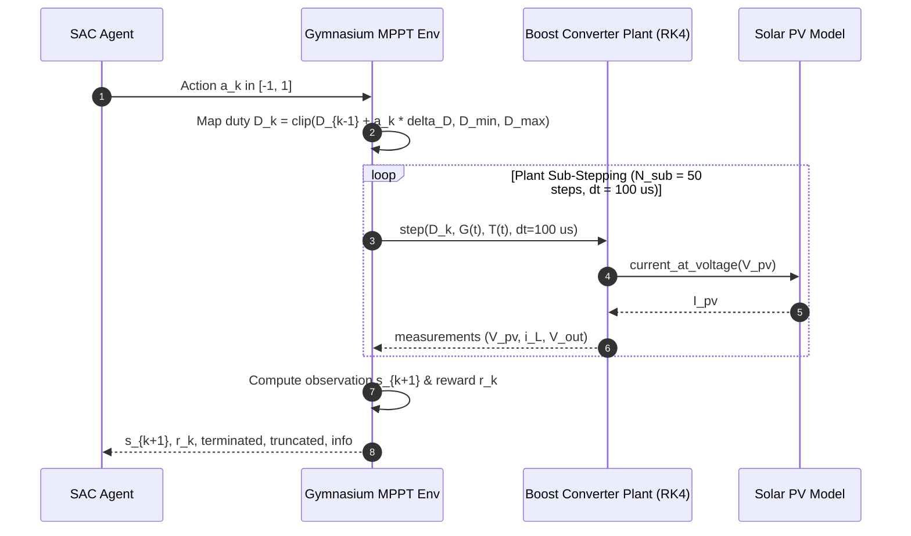
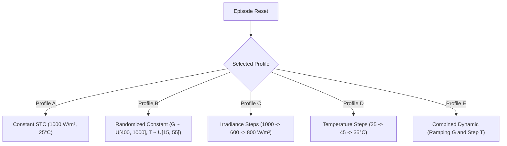

# PHASE 5 THEORY: Gymnasium-Based Reinforcement Learning Environment for Solar MPPT

## 1. Executive Summary & Purpose

This document establishes the theoretical formulation, physical foundations, and mathematical abstractions governing the **Custom Gymnasium Reinforcement Learning Environment** for Maximum Power Point Tracking (MPPT) in a solar photovoltaic (PV) system connected to a DC-DC boost converter.

The objective of the environment is to formulate the continuous-time physical PV-converter dynamics as a discrete-time **Markov Decision Process (MDP)** suitable for continuous-action reinforcement learning algorithms, specifically **Soft Actor-Critic (SAC)**.

The environment bridges the gap between:
1. High-fidelity non-linear physical equations of the single-diode PV model and dynamic state-space boost converter, and
2. The standard `gymnasium.Env` continuous observation/action interface expected by modern reinforcement learning libraries such as Stable-Baselines3.

---

## 2. Markov Decision Process (MDP) Formulation

The MPPT tracking problem is modeled as a stationary, fully observed or partially observed Markov Decision Process defined by the 5-tuple:

$$\mathcal{M} = \langle \mathcal{S}, \mathcal{A}, \mathcal{P}, \mathcal{R}, \gamma \rangle$$

where:
- $\mathcal{S} \subseteq \mathbb{R}^{d_s}$: Continuous state/observation space.
- $\mathcal{A} \subseteq \mathbb{R}^{d_a}$: Continuous action space.
- $\mathcal{P}: \mathcal{S} \times \mathcal{A} \to \mathcal{P}(\mathcal{S})$: State transition probability distribution (governed by the continuous-time converter-PV differential equations integrated over control interval $T_{RL}$).
- $\mathcal{R}: \mathcal{S} \times \mathcal{A} \to \mathbb{R}$: Scalar reward function evaluating power extraction, tracking error, and control effort.
- $\gamma \in [0, 1)$: Discount factor for future rewards ($\gamma = 0.99$ nominal for SAC).

### 2.1 Interaction Cycle

At discrete decision epoch $k \in \{0, 1, 2, \dots, K-1\}$ corresponding to physical time $t_k = k \cdot T_{RL}$:
1. The agent observes state $s_k \in \mathcal{S}$.
2. The agent selects a continuous control action $a_k \in \mathcal{A} = [-1.0, 1.0]$.
3. The environment maps $a_k$ to an absolute converter duty cycle $D_{k} \in [D_{min}, D_{max}]$.
4. A Zero-Order Hold (ZOH) holds $D(t) = D_k$ constant while the boost converter plant integrates forward across $N_{sub} = T_{RL} / \Delta t_{plant}$ sub-steps using 4th-order Runge-Kutta (RK4).
5. The environment measures the terminal electrical response $s_{k+1}$, computes scalar reward $r_k = \mathcal{R}(s_k, a_k, s_{k+1})$, evaluates termination/truncation conditions, and yields diagnostic telemetry.

---

## 3. Multirate Simulation & Timing Dynamics

A central challenge in power electronics RL is the severe timescale disparity between fast electromagnetic switching/filtering dynamics and controller sampling intervals.

### 3.1 Timescale Separation

The physical system possesses three distinct timescales:
1. **Switching Frequency**: $f_{sw} = 20\text{ kHz} \implies T_{sw} = 50\ \mu\text{s}$.
2. **Plant Integration Step**: $\Delta t_{plant} = 100\ \mu\text{s} = 0.1\text{ ms}$.
   - Resolves the state-space averaged dynamics governed by natural resonant frequency $f_0 \approx 232\text{ Hz}$ ($T_0 \approx 4.3\text{ ms}$).
3. **RL Control Epoch**: $T_{RL} = 5.0\text{ ms}$.
   - Number of plant integration steps per RL action:
     $$N_{sub} = \frac{T_{RL}}{\Delta t_{plant}} = \frac{5.0\times 10^{-3}\text{ s}}{1.0\times 10^{-4}\text{ s}} = 50$$



### 3.2 Justification for $T_{RL} = 5\text{ ms}$

If the RL agent acted at the converter integration step $\Delta t_{plant} = 100\ \mu\text{s}$, the agent would experience high-frequency reactive LC ringing, non-minimum-phase right-half-plane zeros, and transient phase inversions. By setting $T_{RL} = 5.0\text{ ms} > T_0 \approx 4.3\text{ ms}$, the converter settles into its quasi-steady-state operating point, presenting a well-conditioned monotonic relationship between duty cycle and PV terminal operating point.

---

## 4. Action Space & Duty-Cycle Mapping

### 4.1 Definition

The action space is a 1-dimensional bounded continuous box:

$$\mathcal{A} = \text{Box}(\text{low}=-1.0, \text{high}=1.0, \text{shape}=(1,), \text{dtype}=\text{np.float32})$$

### 4.2 Incremental Duty-Cycle Formulation

Rather than directly commanding an absolute duty cycle $D \in [0.05, 0.90]$—which can induce massive current surges and converter destabilization upon small neural network perturbations—the action commands an **incremental adjustment** $\Delta D$:

$$D_{k} = \operatorname{clip}\left(D_{k-1} + a_k \cdot \Delta D_{max}, D_{min}, D_{max}\right)$$

where:
- $a_k \in [-1.0, 1.0]$: Scaled neural network output (e.g. from a Tanh squashing layer in SAC).
- $\Delta D_{max} = 0.01$: Maximum permissible duty adjustment per 5 ms step ($2.0\text{ s}^{-1}$ maximum slew rate).
- $D_{min} = 0.05$: Minimum duty cycle (prevents inductor current discontinuity and unboosted operation).
- $D_{max} = 0.90$: Maximum duty cycle (prevents extreme diode reverse recovery losses and excessive conduction loss).

### 4.3 Actual Actuation Reporting

Because of boundary clamping, the actual duty adjustment achieved by the plant may differ from the commanded value:

$$\Delta D_{actual, k} = D_k - D_{k-1}$$

Both $a_k$, $D_k$, $\Delta D_{actual, k}$, and a boolean saturation indicator $\mathbb{I}_{sat} = (D_k \in \{D_{min}, D_{max}\})$ are reported in the diagnostic `info` dictionary.

---

## 5. State & Observation Space Design

The observation vector $s_k \in \mathcal{S}$ must provide sufficient information for the agent to deduce:
1. Current operating position on the $P$-$V$ curve.
2. Local slope sign and curvature ($\operatorname{sgn}(dP/dV)$).
3. Environmental driving conditions ($G, T$).

### 5.1 Observation Features & Normalization

All observation features are normalized to roughly $[-1.0, 1.0]$ or $[0.0, 1.0]$ to ensure well-conditioned gradients in neural network training:

| Index | Feature | Symbol | Physical Meaning | Normalization Formula | Nominal Range |
|---|---|---|---|---|---|
| 0 | $\tilde V_{pv}$ | Normalized PV Voltage | Panel terminal voltage | $V_{pv} / V_{scale}$ ($V_{scale} = 45.0\text{ V}$) | $[0.0, 1.0]$ |
| 1 | $\tilde I_{pv}$ | Normalized PV Current | Panel output current | $I_{pv} / I_{scale}$ ($I_{scale} = 10.0\text{ A}$) | $[0.0, 1.0]$ |
| 2 | $\tilde P_{pv}$ | Normalized PV Power | Extracted power | $P_{pv} / P_{scale}$ ($P_{scale} = 300.0\text{ W}$) | $[0.0, 1.0]$ |
| 3 | $\tilde D$ | Converter Duty Cycle | Current converter duty ratio | $D$ | $[0.05, 0.90]$ |
| 4 | $\widetilde{\Delta V}$ | Voltage Difference | Derivative indicator $V_k - V_{k-1}$ | $\operatorname{clip}((V_k - V_{k-1})/\Delta V_{scale}, -1, 1)$ ($\Delta V_{scale} = 5.0\text{ V}$) | $[-1.0, 1.0]$ |
| 5 | $\widetilde{\Delta P}$ | Power Difference | Derivative indicator $P_k - P_{k-1}$ | $\operatorname{clip}((P_k - P_{k-1})/\Delta P_{scale}, -1, 1)$ ($\Delta P_{scale} = 50.0\text{ W}$) | $[-1.0, 1.0]$ |
| 6 | $\tilde G$ | Normalized Irradiance | Incident solar irradiance | $G / 1000.0\text{ W/m}^2$ | $[0.2, 1.2]$ |
| 7 | $\tilde T$ | Normalized Temperature | Cell junction temperature | $(T - 25.0) / 50.0$ | $[-0.5, 1.0]$ |
| *8 | $\tilde V_{mp}$ | *Ref MPP Voltage | Privileged ground-truth $V_{mp}$ | $V_{mp} / V_{scale}$ | $[0.5, 0.9]$ |
| *9 | $\tilde P_{mp}$ | *Ref MPP Power | Privileged ground-truth $P_{mp}$ | $P_{mp} / P_{scale}$ | $[0.2, 1.0]$ |

*\*Features 8 and 9 are privileged reference inputs. The environment provides a configurable boolean `include_mpp_in_obs`:*
- When `include_mpp_in_obs = True`: $d_s = 10$ (Privileged / Guided training mode).
- When `include_mpp_in_obs = False`: $d_s = 8$ (Realistic standalone measurement mode).

### 5.2 Gymnasium Box Definition

```python
obs_dim = 10 if include_mpp_in_obs else 8
observation_space = gymnasium.spaces.Box(
    low=-2.0,
    high=2.0,
    shape=(obs_dim,),
    dtype=np.float32,
)
```

Observations are strictly typed as `np.float32` and bounded within $[-2.0, 2.0]$.

---

## 6. Reward Function Formulation & Comparison

The reward function guides policy optimization in SAC. An ineffective reward formulation causes policy collapse, limit-cycle chattering, or failure to explore off-MPP regions.

### 6.1 Formulation 1: Simple Normalized Power Ratio
$$r_{ratio}(t) = \frac{P_{pv}(t)}{P_{mpp}(t) + \epsilon} - w_d (\Delta D)^2$$

- **Pros**: Direct interpretation (tracking efficiency fraction).
- **Cons**: Flat gradient near MPP. Because $d(P/P_{mpp})/dD \to 0$ at MPP, the learning gradient vanishes, leading to slow fine-tuning and steady-state drift.

### 6.2 Formulation 2: Hybrid Tracking with Quadratic Penalty (Recommended Primary)
$$r_{hybrid}(t) = w_p \left(\frac{P_{pv}(t)}{P_{mpp}(t) + \epsilon}\right) - w_e \left(\frac{P_{mpp}(t) - P_{pv}(t)}{P_{mpp}(t) + \epsilon}\right)^2 - w_d (a_k)^2 - r_{penalty} \cdot \mathbb{I}_{invalid}$$

where:
- $w_p = 1.0$: Linear power reward encouraging higher power extraction across the full operating range.
- $w_e = 2.0$: Quadratic error penalty providing strong, steep gradients when operating far from MPP while smoothly vanishing at $P_{pv} \to P_{mpp}$.
- $w_d = 0.05$: Control effort regularization penalizing violent duty-cycle adjustments, suppressing high-frequency chattering.
- $r_{penalty} = 10.0$: Penalty applied if numerical failure or extreme over-voltage triggers episode termination.

#### Analytical Gradient Comparison
Let $e_P = \frac{P_{mpp} - P_{pv}}{P_{mpp}}$.
- For Formulation 1: $\frac{\partial r_1}{\partial e_P} = -1.0$ (constant slope).
- For Formulation 2: $\frac{\partial r_2}{\partial e_P} = -1.0 - 2 w_e e_P$.
When far from MPP ($e_P = 0.5$), the gradient magnitude is $1.0 + 4.0(0.5) = 3.0$ (3x steeper signal driving the policy rapidly toward MPP). When close to MPP ($e_P = 0.01$), the quadratic penalty drops to $2.0 \times (0.01)^2 = 0.0002$, allowing the agent to settle smoothly without chattering.

### 6.3 Formulation 3: Power Step Differential ($\Delta P$)
$$r_{\Delta P}(t) = \frac{P_{pv}(t) - P_{pv}(t-1)}{P_{scale}} - w_d (a_k)^2$$
- **Cons**: Penalizes the agent heavily during external environmental irradiance drops, even if the agent acts optimally. Unsuitable for non-stationary environmental profiles.

### 6.4 Selection
**Formulation 2 (`HybridTrackingReward`) is selected as the primary reward formulation.** All weights are fully configurable in `RLEnvConfig`.

---

## 7. Environmental Profiles & Non-Stationarity

To train an agent that outperforms classical P&O under dynamic irradiance and temperature, the environment supports 5 standardized academic profiles:



1. **Profile A (Constant STC)**: Baseline testing at $G = 1000\text{ W/m}^2$, $T = 25^\circ\text{C}$.
2. **Profile B (Randomized Constant)**: Uniform sampling $G \sim \mathcal{U}(400, 1000)\text{ W/m}^2$, $T \sim \mathcal{U}(15, 55)^\circ\text{C}$. Fixed throughout the episode to train general operating point tracking.
3. **Profile C (Irradiance Steps)**: Step reductions and increases (e.g. $1000 \to 600\text{ W/m}^2$ at $t = 0.5\text{ s}$). Tests the agent's ability to track rapid cloud transients without P&O misdirection.
4. **Profile D (Temperature Steps)**: Rapid thermal transitions ($25 \to 45^\circ\text{C}$). Tests voltage tracking along the negative temperature coefficient.
5. **Profile E (Combined Dynamic)**: Simultaneous continuous irradiance ramping and discrete thermal step changes.

---

## 8. Safety, Faults, and Numerical Boundaries

The environment enforces physical and numerical bounds to prevent model divergence during exploratory RL actions:

1. **Duty-Cycle Saturation**: Hard-clamped to $[D_{min}, D_{max}] = [0.05, 0.90]$.
2. **Positivity Invariant**: Non-negative terminal voltages and currents ($V_{pv} \ge 0, i_L \ge 0, V_{out} \ge 0$).
3. **Over-Voltage Terminal Threshold**: If $V_{out} > 120.0\text{ V}$ (well above nominal $48\text{V}$), the episode is terminated with an invalid penalty to teach the agent safe converter operating boundaries.
4. **Non-Finite Detection**: Any `NaN` or `inf` in converter state immediately triggers `terminated = True` with fault diagnostics in `info`.

---

## 9. Compatibility with Stable-Baselines3 and SAC

The environment strictly adheres to Gymnasium 1.0+ and SB3 2.0+ specifications:
- `step()` returns: `tuple[np.ndarray, float, bool, bool, dict[str, Any]]` (`obs, reward, terminated, truncated, info`).
- Observation space: `gymnasium.spaces.Box`.
- Action space: `gymnasium.spaces.Box(low=-1.0, high=1.0, shape=(1,), dtype=np.float32)`.
- Fully passes:
  - `gymnasium.utils.env_checker.check_env`
  - `stable_baselines3.common.env_checker.check_env`
  - `stable_baselines3.common.monitor.Monitor` wrapper.
- SAC compatibility: Single continuous action dimension, bounded $[-1, 1]$, deterministic seeding via `np.random.Generator`.

---

## 10. Summary of Architectural Scope

| Requirement | Implementation Component | Status |
|---|---|---|
| Gymnasium Interface | `SolarMPPTEnv(gymnasium.Env)` in `app/rl/mppt_env.py` | Phase 5 |
| Observation Processing | `ObservationProcessor` in `app/rl/observations.py` | Phase 5 |
| Reward Formulation | `RewardCalculator` in `app/rl/reward.py` | Phase 5 |
| Dynamic Profiles | `EpisodeProfileGenerator` in `app/rl/episode_profiles.py` | Phase 5 |
| Central Configuration | `RLEnvConfig` in `config/default_config.py` | Phase 5 |
| Verification Scripts | `examples/validate_rl_environment.py` | Phase 5 |
| Neural Network / SAC Agent | Reserved for Phase 6 | **Out of Scope** |
