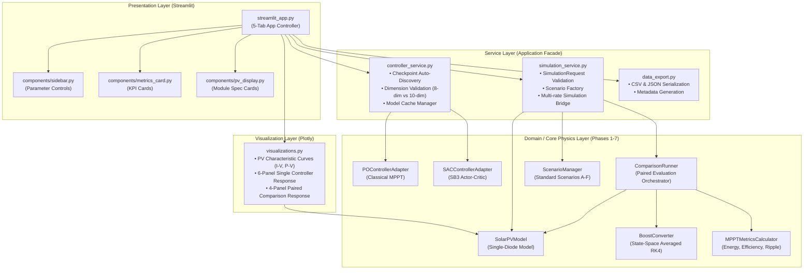
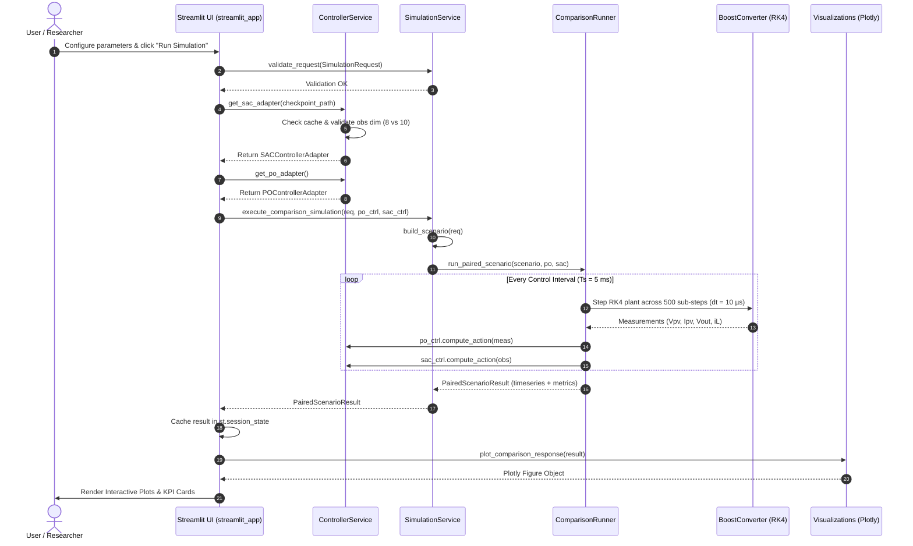

# Phase 8: Interactive Streamlit Dashboard — Technical Architecture

## 1. System Overview & Architectural Objectives

The Phase 8 architecture establishes an interactive, decoupled, and extensible presentation and simulation service layer on top of the validated core physics and control modules developed in Phases 0–7.

### Primary Architectural Principles:
1. **Zero Domain Duplication**: The dashboard does not reimplement or duplicate single-diode equations, state-space converter dynamics, P&O logic, SAC inference, or metric calculations.
2. **Layered Decoupling**: Pure separation of concerns between UI presentation, plotting logic, orchestration services, and domain execution.
3. **Observation Dimension Integrity**: Automatic validation of SAC policy neural network input dimensions ($8\text{-dim}$ realistic vs $10\text{-dim}$ privileged).
4. **Caching & Efficiency**: Heavy neural network models and baseline configurations are cached in memory via `@st.cache_resource`, while simulation trajectories are maintained in session state.
5. **Exact Physical Conservation**: All energy calculations strictly adhere to the audited physical identity $E_{ideal} \equiv E_{harvested} + E_{loss}$.

---

## 2. Layered Architecture Diagram

---

## 3. Subsystem Breakdown & Module Roles

### 3.1 Presentation Layer (`app/dashboard/`)
- **`streamlit_app.py`**: The application entry point and tab controller. Configures the Streamlit page layout (`wide`), loads custom CSS styling, initializes session states, delegates user inputs to services, and renders the 5 core workspace tabs:
  - Tab 1: System Overview & Physical Architecture
  - Tab 2: PV Characteristics & Operating Point Analyzer
  - Tab 3: Interactive MPPT Simulation & Dynamic Response
  - Tab 4: Performance Analytics & Benchmark Scenarios (A–F)
  - Tab 5: Data Export & Documentation
- **`components/sidebar.py`**: Renders all interactive controls (execution mode, model selector, profile selector, sliders for $G, T, R_{load}, D_0, \text{duration}$) and returns a strongly-typed `SimulationRequest` dataclass.
- **`components/metrics_card.py`**: Renders responsive HTML/CSS KPI cards displaying tracking efficiency $\eta_{MPPT}$, harvested energy $E_{harv}$, theoretical ideal $E_{ideal}$, energy loss $E_{loss}$, steady-state ripple $\sigma_P$, and settling time $t_s$.
- **`components/pv_display.py`**: Renders nameplate physical ratings and computed maximum power point parameters for the Canadian Solar CS6P-240P PV module.

### 3.2 Visualization Layer (`app/dashboard/visualizations.py`)
- Built exclusively with **Plotly Graph Objects** (`plotly.graph_objects`), providing interactive zooming, panning, hover inspections, and toggling of traces.
- Supports both Light and Dark mode styling matching the dashboard aesthetic.
- Key figures generated:
  - `plot_pv_characteristics`: Dual-panel I-V and P-V curves with MPP markers and dynamic operating point projection.
  - `plot_single_controller_response`: 6-panel synchronized timeseries showing $P_{pv}$ vs $P_{MPP}$, tracking error, $V_{pv}$ & $I_{pv}$, $V_{out}$, $D(t)$, and ambient conditions.
  - `plot_comparison_response`: 4-panel comparative overlay comparing P&O and SAC trajectories ($P_{pv}(t)$, instantaneous tracking error, duty cycle actuation $D(t)$, and converter output voltage $V_{out}(t)$).

### 3.3 Service Layer (`app/dashboard/`)
- **`controller_service.py`**:
  - `discover_checkpoints()`: Scans the `artifacts/rl/` directory recursively to find all trained SAC model checkpoints (`.zip`), extracting architecture metadata and observation dimensions.
  - `load_sac_model()`: Wrapped with `@st.cache_resource` to prevent reloading heavy PyTorch neural networks on every Streamlit rerun.
  - `validate_observation_space()`: Inspects the policy's observation space (`model.observation_space.shape[0]`). If an 8-dim policy is selected, automatically configures the non-privileged feature adapter. If a 10-dim policy is selected, enables the privileged adapter.
  - Factory methods `create_po_adapter()` and `create_sac_adapter()`.
- **`simulation_service.py`**:
  - `validate_request()`: Rigorously verifies all user inputs against physical boundaries ($100 \le G \le 1200\text{ W/m}^2$, $-10 \le T \le 75^\circ\text{C}$, $5 \le R_{load} \le 100\ \Omega$, $0.10 \le D_0 \le 0.85$, $0.5 \le \text{duration} \le 3.0\text{ s}$).
  - `build_scenario()`: Translates preset or custom UI requests into executable `ScenarioDefinition` objects.
  - `execute_single_simulation()` and `execute_comparison_simulation()`: Configures isolated `ComparisonRunner` instances with customized converter parameters ($R_{load}$) and runs multirate simulation ($dt = 10\ \mu\text{s}$, $T_s = 5.0\text{ ms}$).
- **`data_export.py`**:
  - Serializes simulation timeseries, metrics, paired comparison records, and configuration metadata into standardized CSV and JSON formats ready for one-click browser download.

---

## 4. Execution & Data Flow

---

## 5. Caching & Memory Management Strategy

1. **Neural Network Caching (`@st.cache_resource`)**:
   - Loading PyTorch neural networks from disk is computationally expensive ($\approx 1.5\text{ s}$).
   - `ControllerService.load_sac_model()` is decorated with `@st.cache_resource`. When a user re-runs simulations or tweaks sliders, the existing loaded policy network in RAM is reused immediately, reducing simulation invocation overhead to zero.
2. **Base Configuration Caching (`@st.cache_resource`)**:
   - `get_default_config()` is cached so disk I/O for `default_config.py` is avoided.
3. **Session State Storage (`st.session_state`)**:
   - Simulation results (`last_sim_result`, `last_comp_result`, `last_pv_curve`) are stored in `st.session_state`.
   - When users switch between tabs (e.g., from Simulation Tab 3 to Export Tab 5), the entire timeseries and metrics are preserved without requiring re-simulation.

---

## 6. Error Handling & Safety Boundaries

| Risk / Failure Mode | Preventive Architecture | Recovery Mechanism |
|---|---|---|
| **Out-of-bounds user inputs** | Slider limits + explicit `validate_request()` in `SimulationService` | Throws `ValueError` with clear descriptive message displayed via `st.error()`. |
| **Observation space dimension mismatch** | `ControllerService.validate_observation_space()` inspects model input dimensions | Detects if model requires 8 features (realistic) or 10 features (privileged) and automatically initializes matching adapter. |
| **Missing checkpoint file** | `discover_checkpoints()` checks existence on disk | Falls back to default realistic model; if missing, displays prominent error. |
| **Plant integration numerical failure** | Boost converter RK4 integration catches math errors and clips negative currents | Converter sets fault flag, preserves finite state, and returns last stable measurement. |
| **Streamlit re-run state loss** | State preserved in `st.session_state` | All simulation data remains accessible across tab switches. |
